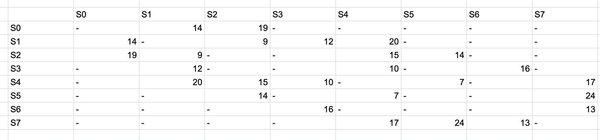
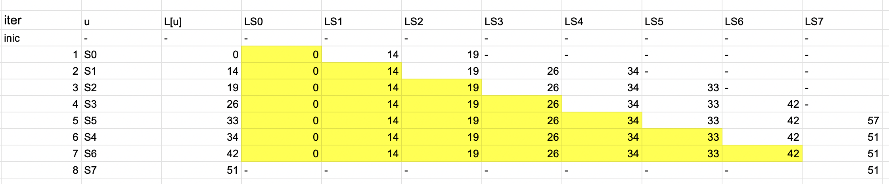
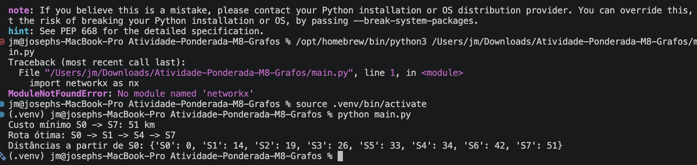
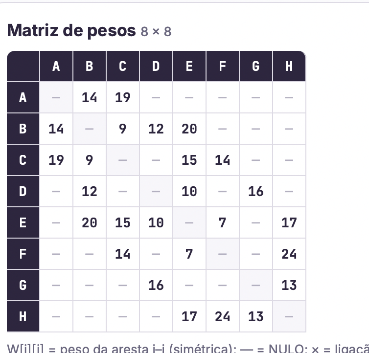
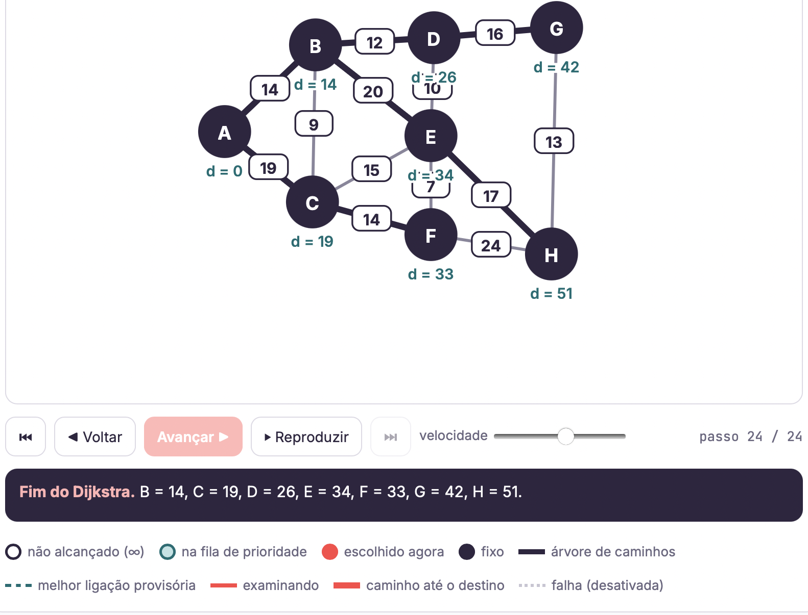
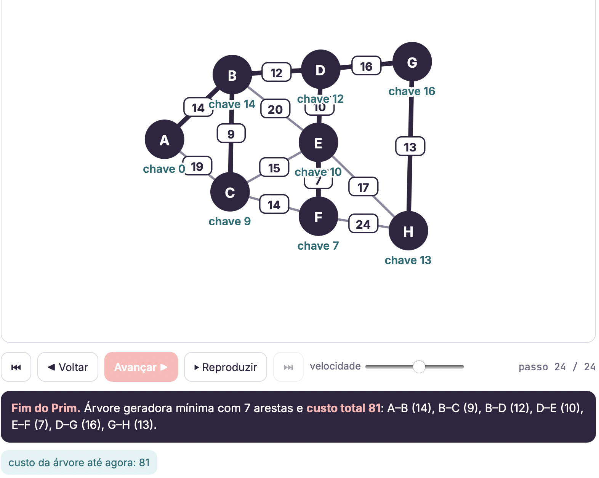
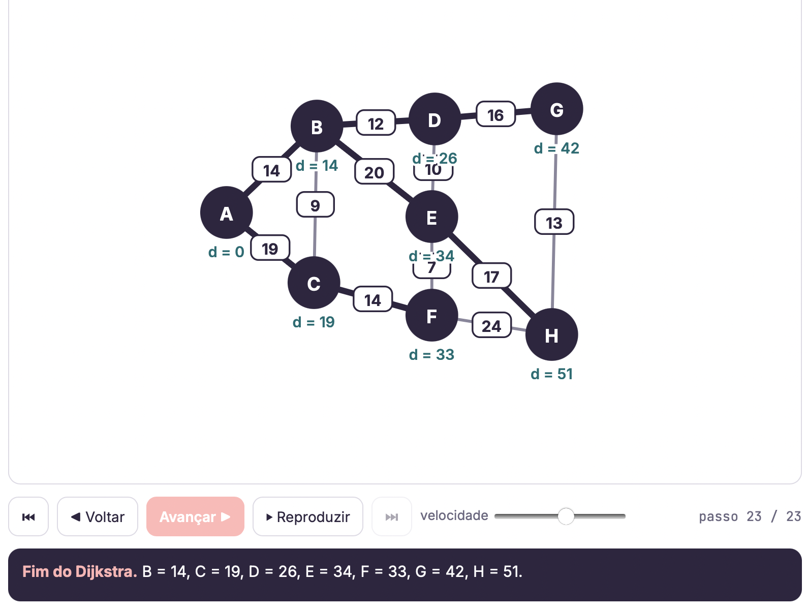

# Atividade-Ponderada-M8-Grafos
Atividade de Grafos.

meu RA: A2025.1A.0144

Etapa 1 (ia demorar escrever todas as contas aqui): 

w1 = 10 + (4 % 5) = 14
w2 = 15 + (4 % 7) = 19
w3 = 8 + (1 % 4) = 9
w4 = 12
w5 = 15
w6 = 14
w7 = 10
w8 = 16
w9 = 7
w10 = 17
w11 = 24
w12 = 13
w13 = 20


diagrama topoógico: desenhei na mão
 
Matriz de pesos 8 x 8: fiz no google sheets porque ia demorar muito tempo, cofundiu algumas vezes pelo grafico ser espelhado




Etapa 2: 

Eu fiz no google sheets também, eu fiz varios exercicios desse antes de começar a aula que ajudou muito. Unico problema foi que uma hora foi do vértice S3 para o S5 no lugar do S4 que confunde um pouco também. A parte de antecessores eu deixei para depois se sobrasse tempo porque não achei ser muito importante.



Etapa 3: Aqui eu usei o netwrokX que é muito bom 

O código ta no arquivo main.py. Aqui eu pedi ajuda só para conseguir rodar a biblioteca porque o homebrew não tava me deixando. Acho que porque não pode instalar biblioteca direto no sistema:

```
python3 -m venv .venv
source .venv/bin/activate
pip install networkx
python main.py
```

Ai aqui o grafo é montado com os 8 vértices e os 13 pesos calculados na Etapa 1. O caminho mínimo fo calculado com nx.single_source_dijkstra (muito bom) e `nx.single_source_dijkstra_path_length` (distância de S0 até todos os vértices acho).

Resultado: custo mínimo de 51 km pela rota S0 → S1 → S4 → S7.



### Conferência com o simulador do professor

Pra validar eu montei o mesmo grafo no simulador que tinha sido passado no slack: https://murilo-zc.github.io/estruturas-de-dados/prim-dijkstra.html

O simulador usa letras no lugar de S0 a S7: A=S0, B=S1, C=S2, D=S3, E=S4, F=S5, G=S6, H=S7.

**Matriz de pesos 8×8** (ficou igual a minha, e pelo o que entendi serve para o código que eu não saberia escrever na mão):



Dijkstra a partir de A (S0): B=14, C=19, D=26, E=34, F=33, G=42, H=51. A árvore de caminhos mostra a rota A → B → E → H, ou seja, S0 → S1 → S4 → S7 com 51 km.



**Prim:** árvore geradora mínima com custo total de 81 km.



## Confronto código × teste de mesa

| | Teste de mesa (Etapa 2) | Código (`main.py`) | Simulador |
|---|---|---|---|
| Custo até S7 | 51 | 51 | 51 |
| Rota | S0 → S1 → S4 → S7 | S0 → S1 → S4 → S7 | A → B → E → H |
| Distâncias finais | S1=14, S2=19, S3=26, S4=34, S5=33, S6=42, S7=51 | iguais | iguais |

Os três resultados ficaram iguais (oba). Aqui tem um ponto que foi comentado na aula que o Dijkstra só iria trocar o antecesosor se o valor fosse menor e não se o valor foi igual o maior

Etapa 4:

### Questão 1  Rota e custo ótimo

A distância mínima de S0 até S7 é 51 km, pela rota S0 → S1 → S4 → S7 (14 + 20 + 17 = 51).

Ordem que os vértices foram fechados pelo Dijkstra foi S0, S1, S2, S3, S5, S4, S6, S7.

O S5 fecha antes do S4 porque S5 tinha distância 33 e S4 tinha 34 e o Dijkstra fecha o vértice aberto de menor distância.

### Questão 2  Contingência no ramal (S2, S4)

Tirar essa aresta não mudou nada, o caminho continuou 51km. Isso porque a aresta não fazia parte da rota do Dijkstra, então o o acrécimo de custo em km foi 0%:



### Questão 3 — Prim (MST) × Dijkstra

Árvore Geradora Mínima (do Prim a partir de S0): S0–S1 (14), S1–S2 (9), S1–S3 (12), S3–S4 (10), S4–S5 (7), S3–S6 (16), S6–S7 (13). Isso deu um custo total de 81 km.

Dijkstra, somando as distâncias de S0 até os outros vértices deu 0 + 14 + 19 + 26 + 34 + 33 + 42 + 51 = 219 km.

A árvore feita pelas rotas do Dijkstra usa as arestas S0–S1 (14), S0–S2 (19), S1–S3 (12), S1–S4 (20), S2–S5 (14), S3–S6 (16) e S4–S7 (17), com peso total de 112 km** contra 81 km da MST.

Por que a união das rotas do Dijkstra não forma a MST?: Isso porque os dois algoritmos otimizam coisas diferentes.

O Dijkstra minimiza a distância acumulada desde a origem até cada subestação. Por isso ele usa S0–S2 (19) direto no lugar de S1–S2 (9). O caminho S0 → S1 → S2 custaria 14 + 9 = 23 que é maior que 19.
O Prim minimiza o custo total de cabo pra conectar todas as etações, não importa de onde começar com a origem.

Ou seja o Dijkstra responde qual o caminho mais rápido para a equipe chegar de S0 até cada ponto, e o Prim responde qual o jeito mais barato de construir a rede ligando tudo. A MST foi mais barata de construir, mas nela algumas subestações ficam mais longe da origem.
